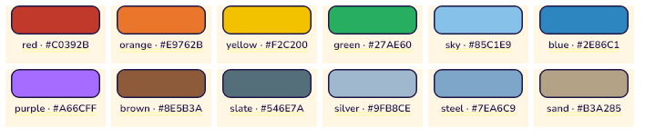

# Making a Shape Race puzzle

A puzzle is data, not code: one file in [`packages/puzzle_game/puzzles/`](../packages/puzzle_game/puzzles), listed in `index.json`. The app loads the whole library from those files, so a new picture needs no Dart change. This page has what a file's fields mean, the rules the library keeps, and the four commands that carry a puzzle from nothing to a picture to commit.

## The board and its coordinates

Board units: the board is **80 wide and 72 high**, `(0, 0)` at its top left, x to the right and y downwards. The board sits in the game's 160 × 90 field, with room round it for the players' dots.

```
(0,0) x ──────────────▶
  ┌──────────────────────────────┐
y │                              │
│ │         80 × 72 board        │
▼ │                              │
  └──────────────────────────────┘
            y 72 at the bottom
```

A piece's `at` is where its outline's **origin** goes on the board. The origin is the shape's `(0, 0)`, the point the players' dot pushes and the piece turns about, so it must lie strictly inside the shape: draw the points round it, not from a corner.

## The file

```json
{
  "$schema": "puzzle.schema.json",
  "format": 1,
  "id": "sun",
  "name": "Sun",
  "level": "easy",
  "notes": "Anything for the next developer; the app ignores it.",
  "pieces": [ … ]
}
```

| Field | What it is |
| --- | --- |
| `$schema` | Points the editor at [`puzzle.schema.json`](../packages/puzzle_game/puzzles/puzzle.schema.json), so VS Code completes the fields and underlines a mistake as you type. The app ignores it. |
| `format` | The file format's version, `1` today. A missing `format` means 1; a file with a higher number than the app knows is refused with a message saying to update the app, rather than loaded wrong. |
| `id` | The file's name without `.json`, and its line in `index.json`. |
| `name` | What the players read in the puzzle list. |
| `level` | `"easy"` or `"medium"`: which list it is in and which rules below it keeps. |
| `notes` | Optional, free text, ignored by the app. |
| `pieces` | The pieces, in drawing order (below). |

## A piece

```json
{"id": "roof", "shape": {"polygon": [[-20, 8], [20, 8], [0, -14]]}, "color": "red", "at": [40, 20], "rotated": true}
```

| Field | What it is |
| --- | --- |
| `id` | The piece's name in `check`'s messages and in the code; unique in the puzzle. |
| `shape` | `{"circle": radius}`, `{"rect": [width, height]}`, `{"regular": [corners, radius]}` (first corner straight up) or `{"polygon": [[x, y], …]}` with at least 3 corners, all around the origin. |
| `color` | A colour token (`"red"`, `"sky"`, `"silver"`) or `"#RRGGBB"`. |
| `at` | Where the origin goes on the board: `[x, y]`. |
| `angle` | Optional: the angle the piece belongs at, in degrees clockwise, when the shape is drawn sideways. Default 0. |
| `rotated` | Optional: the piece starts at a random angle, so it must be turned before it fits. Every puzzle has at least 2; an Easy one exactly 2. |
| `big` | Optional: a big piece, which two players carry together. Medium has 1 or 2. |
| `kind` | Optional: pieces of one kind are interchangeable, so they must have the same shape and size (the boat's two waves). |

Pieces are drawn in the order they are written: a later piece lies over an earlier one (a window over a wall).

### Turning and symmetry

A piece needs turning when `rotated` is set. Every puzzle starts at least 2 pieces turned, and an Easy one no more than 2. A circle doesn't count, since it can't be turned. A square comes back onto itself every quarter turn, a rectangle every half turn, a regular polygon every `360° / corners`, a circle at any angle (so a circle can't be turned and must not be `rotated`). The app snaps a piece onto its outline by the nearest look-alike angle, so a circle with `rotated` would be unfair, and `check` says so.

## Rules by level

| | Easy | Medium |
| --- | --- | --- |
| Pieces | 4 to 5 | 6 to 8 |
| Turned pieces (`rotated`, not circles) | exactly 2 | at least 2 |
| Big pieces (`big`) | any | 1 or 2 |
| Pieces of one shape and size | none | at most one pair |

Every puzzle, whatever its level, also keeps these: each piece's outline lies on the board; the pieces fit the tray on one board and on the split screen; every piece stands out from the board in Sunny and Night; two pieces of one puzzle are told apart unless they share a shape; the finished picture spans at least 60% of the board's width or height, so it reads as one picture rather than a few pieces in a corner. `tools/puzzle.sh check` prints every rule the file breaks, one line each, with a message saying what to change. The rules themselves live in [`puzzle_rules.dart`](../packages/puzzle_game/lib/src/puzzle_rules.dart).

### Fitting the tray

The tray beside the board is **54 wide and 72 high**. At the start the pieces are laid in it in rows, tallest first, each at its starting angle. So the biggest piece and the next row together have to fit in 72 units of height, and a row's pieces in 54 of width. Some things that help:

- A big piece that is wider than tall fits better than a round one of the same span: the tray's rows stack downwards. The redrawn sun's rays are 50 × 38, not 48 × 48.
- A turned piece takes the room of its widest angle, so a long bar that starts turned needs more room than one that doesn't.
- Pieces may share a centre (the sun's face sits on its rays); the later one is drawn on top.
- The picture must still span 60% of the board's width or height. If the tray and the span pull against each other, make the big piece wider and shorter rather than smaller.

## Colour tokens

A `color` is a token or `"#RRGGBB"`. Every token stands out from the board in both looks (Sunny and Night), which a test proves for the whole table.



| Token | Hex | Sunny | Night |
| --- | --- | --- | --- |
| `red` | #C0392B | 0.441 | 0.321 |
| `orange` | #E9762B | 0.299 | 0.437 |
| `yellow` | #F2C200 | 0.177 | 0.575 |
| `green` | #27AE60 | 0.330 | 0.415 |
| `sky` | #85C1E9 | 0.213 | 0.451 |
| `blue` | #2E86C1 | 0.396 | 0.267 |
| `purple` | #A66CFF | 0.386 | 0.332 |
| `brown` | #8E5B3A | 0.440 | 0.265 |
| `slate` | #546E7A | 0.441 | 0.213 |
| `silver` | #9FB8CE | 0.204 | 0.440 |
| `steel` | #7EA6C9 | 0.271 | 0.376 |
| `sand` | #B3A285 | 0.238 | 0.416 |

The two numbers are the OKLab distance from the board in each look; a piece is seen when it keeps 0.15 or more. A colour the table has no name for is written as a hex code, and `check` asks for more distance if it sits too close to the board.

## Workflow

```bash
tools/puzzle.sh new cat-face --level easy --name "Cat Face"   # file from the template, id in index.json
# edit packages/puzzle_game/puzzles/cat-face.json
tools/puzzle.sh check cat-face        # the rules; no id checks the whole library
tools/puzzle.sh render cat-face       # writes docs/design/puzzles/cat-face.png
# look at the picture: start in the tray, finished picture, Sunny and Night
```

Before you commit, run the full puzzle and phone tests too:

```bash
tools/check.sh puzzle phone
```

Three rules aren't in `check` yet, so only these tests catch them:

- **At least 2 turned pieces** (`packages/puzzle_game/test/rules_test.dart`).
- **The tray, at every starting angle:** over 200 random starts, no two pieces overlap in the tray and none leaves it (`rules_test.dart`). `check` only tests that the pieces' total size fits.
- **Big enough to see on a phone:** every piece is at least 8.5 mm on the smallest phones, on every seed (`controller_app/test/puzzle_size_test.dart`). A thin bar is the usual failure; 14 × 4 passes where 12 × 3 doesn't.

The puzzle tests also redraw `docs/design/m13-puzzles.png` and `m13-puzzles-night.png`, the sheets of every puzzle; commit them with the puzzle.

Then commit the puzzle file, its line in `index.json`, its render and anything else the picture needed. `new` makes an Easy 4-piece picture that already passes `check`; edit it from there. Files whose names start with `_` are never puzzles (`_template.json` is what `new` copies), and `check` checks the whole library when given no id, so a broken neighbour is caught too.
